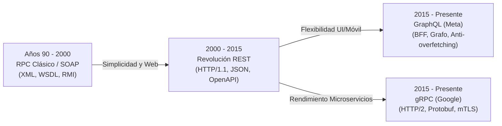
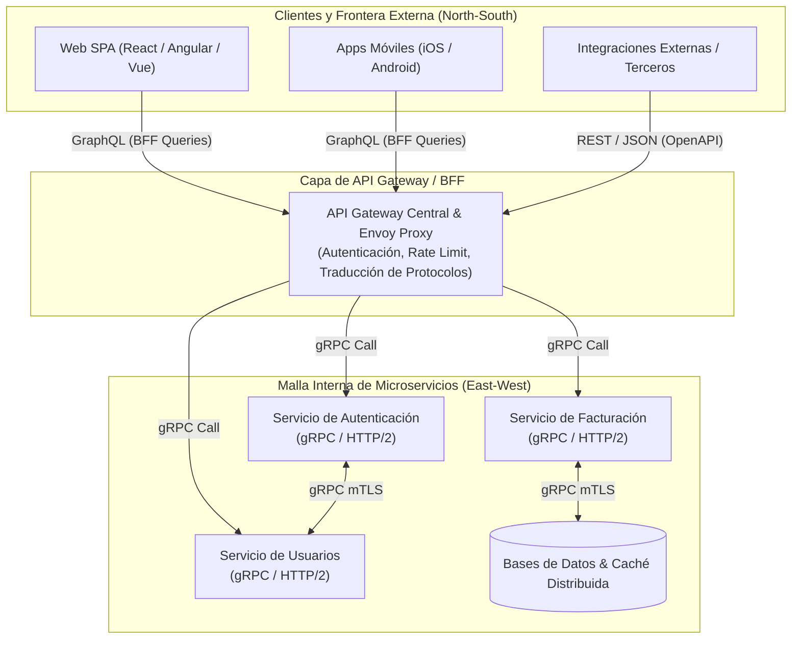
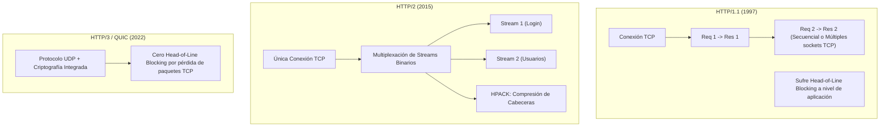
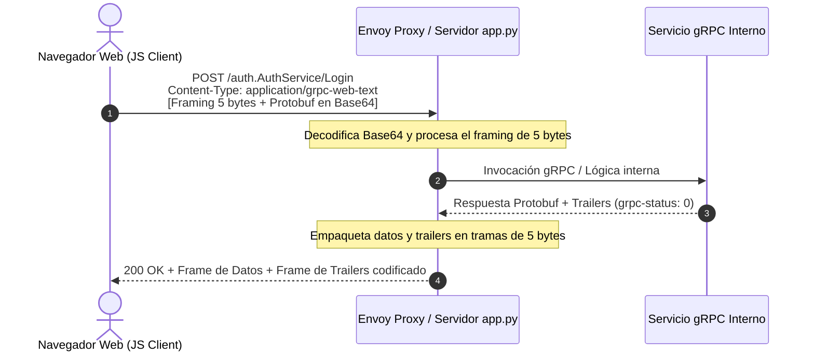
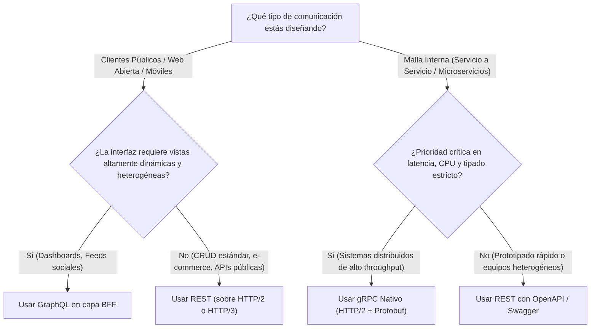

# Informe Técnico: Paradigmas de Arquitectura y Comunicación de APIs (REST, GraphQL, gRPC)

> **Documento Técnico de Referencia, Manual de Inicio Rápido e Informe de Arquitectura de Sistemas CRUD**  
> *Autor:* Laboratorio de Arquitectura de Software & Investigación de Protocolos  
> *Fecha de emisión:* Noviembre 2026  
> *Clasificación:* Guía Práctica, Documentación de Código y Demostración Experimental

---

## 🚀 Guía Rápida: Cómo Iniciar Todo

Para levantar el laboratorio interactivo y probar los 3 paradigmas en tiempo real, seguí estos sencillos pasos:

### 1. Requisitos Previos
- **Python 3.8 o superior** instalado en el sistema.
- **Cero dependencias externas**: no requiere `pip install`, ni bases de datos externas, ni Node.js.

### 2. Iniciar el Servidor Web y API
Abrí tu terminal (PowerShell, CMD o Bash) en la carpeta raíz del proyecto y ejecutá:

```powershell
cd c:\Users\Usuario\Desktop\Diferencias_sistemas_CRUD
python app.py
```

Verás la confirmación en la consola:
```text
======================================================================
   SERVIDOR DE COMPARATIVA CRUD (REST vs GRAPHQL vs gRPC)
======================================================================
 > Interfaz Web y Demostración : http://localhost:8000
 > Directorio Raiz              : C:\Users\Ram_102Gb\Desktop\Diferencias_sistemas_CRUD
 > Endpoints Activos:
    - REST API       : POST http://localhost:8000/api/v1/auth/login
    - GraphQL API    : POST http://localhost:8000/graphql
    - gRPC-Web API   : POST http://localhost:8000/auth.AuthService/Login
======================================================================
Presiona Ctrl+C para detener el servidor.
```

### 3. Abrir la Aplicación Interactiva en el Navegador
Abrí tu navegador web e ingresá a:

👉 **[http://localhost:8000](http://localhost:8000)**

### 4. Credenciales de Prueba Disponibles
- **Usuario:** `admin` | **Contraseña:** `123456` *(Rol: `ADMIN`)*
- **Usuario:** `juan`  | **Contraseña:** `123456` *(Rol: `DEV_LEAD`)*

### 5. Comandos Adicionales de Verificación (en otra terminal)
- **Suite de Pruebas Automatizadas (End-to-End):**
  ```powershell
  python test_server.py
  ```
- **Demostración Matemática CLI (Densidad de Bytes Protobuf vs JSON):**
  ```powershell
  python comparativa_bytes.py
  ```

---

## 📑 Tabla de Contenidos

1. [Resumen Ejecutivo](#1-resumen-ejecutivo)
2. [Estructura del Proyecto y Ficha Técnica de Componentes](#2-estructura-del-proyecto-y-ficha-técnica-de-componentes)
3. [Evolución Histórica de los Sistemas de Intercambio de Datos](#3-evolución-histórica-de-los-sistemas-de-intercambio-de-datos)
4. [Análisis Profundo de los 3 Paradigmas CRUD](#4-análisis-profundo-de-los-3-paradigmas-crud)
   - [4.1. REST (Representational State Transfer)](#41-rest-representational-state-transfer)
   - [4.2. GraphQL](#42-graphql)
   - [4.3. gRPC (gRPC Remote Procedure Call)](#43-grpc-grpc-remote-procedure-call)
5. [Matriz Comparativa de Arquitectura](#5-matriz-comparativa-de-arquitectura)
6. [Recomendaciones de Implementación Arquitectónica en Producción](#6-recomendaciones-de-implementación-arquitectónica-en-producción)
7. [Ingeniería de Protocol Buffers y Análisis a Nivel de Bytes](#7-ingeniería-de-protocol-buffers-y-análisis-a-nivel-de-bytes)
   - [7.1. El Formato TLV (Tag-Length-Value) y Wire Types](#71-el-formato-tlv-tag-length-value-y-wire-types)
   - [7.2. Codificación Varint (LEB128)](#72-codificación-varint-leb128)
   - [7.3. Desglose Byte por Byte: Objeto Canónico `{id: 42, nombre: "Juan"}`](#73-desglose-byte-por-byte-objeto-canónico-id-42-nombre-juan)
   - [7.4. Desglose en Autenticación: Payload de Login](#74-desglose-en-autenticación-payload-de-login)
8. [El Transporte de Red y la Barrera del Navegador](#8-el-transporte-de-red-y-la-barrera-del-navegador)
   - [8.1. HTTP/1.1 vs HTTP/2 vs HTTP/3 (QUIC)](#81-http11-vs-http2-vs-http3-quic)
   - [8.2. ¿Por qué los navegadores no pueden hablar gRPC nativo?](#82-por-qué-los-navegadores-no-pueden-hablar-grpc-nativo)
   - [8.3. gRPC-Web, Framing de 5 Bytes y Trailers de Respuesta](#83-grpc-web-framing-de-5-bytes-y-trailers-de-respuesta)
   - [8.4. La Realidad del Streaming: Unario, Server-Streaming y Bidireccional](#84-la-realidad-del-streaming-unario-server-streaming-y-bidireccional)
9. [Autenticación y Seguridad en los 3 Paradigmas](#9-autenticación-y-seguridad-en-los-3-paradigmas)
10. [Análisis de Ingeniería del Código Fuente](#10-análisis-de-ingeniería-del-código-fuente)
   - [10.1. Servidor Multi-protocolo (`app.py`)](#101-servidor-multi-protocolo-apppy)
   - [10.2. Dashboard Cliente e Inspector Hexadecimal (`index.html`)](#102-dashboard-cliente-e-inspector-hexadecimal-indexhtml)
   - [10.3. Script de Laboratorio CLI (`comparativa_bytes.py`)](#103-script-de-laboratorio-cli-comparativa_bytespy)
   - [10.4. Suite de Pruebas Automatizadas (`test_server.py`)](#104-suite-de-pruebas-automatizadas-test_serverpy)
11. [Resultados Experimentales y Métricas de Laboratorio](#11-resultados-experimentales-y-métricas-de-laboratorio)
12. [Conclusiones y Árbol de Decisión Arquitectónica](#12-conclusiones-y-árbol-de-decisión-arquitectónica)

---

## 1. Resumen Ejecutivo

Este documento detalla las especificaciones, características arquitectónicas y casos de uso de los tres principales protocolos y estilos arquitectónicos utilizados en la ingeniería de software moderna para la comunicación entre sistemas: **REST**, **GraphQL** y **gRPC**.

En el diseño contemporáneo de arquitecturas distribuidas y servicios CRUD (*Create, Read, Update, Delete*), la elección del protocolo de red y del formato de serialización incide directamente en:
- **Latencia de extremo a extremo** y tiempo de respuesta percibido por el usuario.
- **Ancho de banda transferido**, consumo de datos móviles y costes de salida (*egress*) en la nube.
- **Sobrecarga de CPU** ligada a la serialización y parseo de datos (texto ASCII/UTF-8 vs binario empaquetado).
- **Mantenibilidad, tipado estricto y gobernanza de esquemas** en equipos de desarrollo a gran escala.

Este informe y laboratorio práctico desmitifica premisas comunes de la industria:
1. *"REST es lento":* REST es un patrón arquitectónico agnóstico al transporte; al ejecutarse sobre **HTTP/2 o HTTP/3**, se beneficia de multiplexación y compresión de cabeceras.
2. *"gRPC es siempre superior":* gRPC destaca en comunicación interna entre microservicios, pero en el navegador exige capas de adaptación (**gRPC-Web**) debido a restricciones del API de red del browser.
3. *"GraphQL sustituye a REST":* GraphQL soluciona el *over-fetching* y simplifica agregaciones para interfaces cliente complejas (*BFF - Backend for Frontend*), a costa de sacrificar la caché HTTP nativa y añadir complejidad de cálculo en el servidor.

---

## 2. Estructura del Proyecto y Ficha Técnica de Componentes

El proyecto fue diseñado como un **laboratorio experimental autónomo y de cero dependencias externas**, implementado exclusivamente con la biblioteca estándar de Python 3 y JavaScript moderno en el cliente:

```
Diferencias_sistemas_CRUD/
├── app.py                         # Servidor HTTP multi-protocolo (REST, GraphQL, gRPC-Web)
├── index.html                     # Dashboard SPA interactivo, inspector hexadecimal y telemetría
├── Informacion-de-REST.html       # Informe técnico interactivo dedicado a REST
├── Informacion-de-GraphQL.html    # Informe técnico interactivo dedicado a GraphQL
├── Informacion-de-gRPC.html       # Informe técnico interactivo dedicado a gRPC y Protobuf
├── comparativa_bytes.py           # Script CLI demostrativo de serialización Protobuf vs JSON
├── test_server.py                 # Suite de pruebas automatizadas de integración de endpoints
└── README.md                      # Informe técnico, documentación arquitectónica y manual
```

### Ficha Técnica de Archivos

| Archivo | Rol en el Sistema | Tecnologías / Módulos Utilizados | Dependencias Externas |
| :--- | :--- | :--- | :---: |
| [`app.py`](file:///c:/Users/Ram_102Gb/Desktop/Diferencias_sistemas_CRUD/app.py) | Servidor HTTP multi-protocolo y motor Protobuf nativo | `http.server`, `struct`, `base64`, `json`, `urllib.parse` | **0** (Solo Python Standard Lib) |
| [`index.html`](file:///c:/Users/Ram_102Gb/Desktop/Diferencias_sistemas_CRUD/index.html) | Interfaz gráfica SPA, telemetría y codificador binario | HTML5, Tailwind CSS (CDN), JS Vanilla (`DataView`, `Uint8Array`) | **0** (Sin npm ni bundlers) |
| [`Informacion-de-REST.html`](file:///c:/Users/Ram_102Gb/Desktop/Diferencias_sistemas_CRUD/Informacion-de-REST.html) | Página dedicada del informe técnico de REST | HTML5, Tailwind CSS, Semántica HTTP y tablas CRUD | **0** (Standalone) |
| [`Informacion-de-GraphQL.html`](file:///c:/Users/Ram_102Gb/Desktop/Diferencias_sistemas_CRUD/Informacion-de-GraphQL.html) | Página dedicada del informe técnico de GraphQL | HTML5, Tailwind CSS, Schema SDL y Resolvers | **0** (Standalone) |
| [`Informacion-de-gRPC.html`](file:///c:/Users/Ram_102Gb/Desktop/Diferencias_sistemas_CRUD/Informacion-de-gRPC.html) | Página dedicada del informe técnico de gRPC | HTML5, Tailwind CSS, Protobuf y Framing 5 bytes | **0** (Standalone) |
| [`comparativa_bytes.py`](file:///c:/Users/Ram_102Gb/Desktop/Diferencias_sistemas_CRUD/comparativa_bytes.py) | Demostración matemática CLI de densidad en bytes | `json`, codificación Varint LEB128 pura | **0** (Solo Python Standard Lib) |
| [`test_server.py`](file:///c:/Users/Ram_102Gb/Desktop/Diferencias_sistemas_CRUD/test_server.py) | Suite de pruebas unitarias y de integración end-to-end | `subprocess`, `urllib.request`, `base64`, `json`, `time` | **0** (Solo Python Standard Lib) |

---

## 3. Evolución Histórica de los Sistemas de Intercambio de Datos



1. **SOAP y RPC Clásico (1995-2005):** Basados en XML con contratos rígidos (WSDL). El sobrecoste de parseo y la complejidad del estándar derivaron en baja adopción en la web ágil.
2. **REST y JSON (2000-2015):** Formulado por Roy Fielding. Adoptó el modelo de recursos con verbos HTTP (`GET`, `POST`, `PUT`, `DELETE`). JSON simplificó la deserialización nativa en JavaScript.
3. **GraphQL (2015):** Creado internamente por Meta para solventar la diversidad de pantallas móviles y reducir la sobrecarga de consultas en redes lentas.
4. **gRPC (2015):** Sucesor del sistema interno *Stubby* de Google. Combina contratos estrictos `.proto`, serialización binaria de ultra alta densidad y transporte multiplexado HTTP/2.

---

## 4. Análisis Profundo de los 3 Paradigmas CRUD

### 4.1. REST (Representational State Transfer)

REST es un estilo de arquitectura de software que define un conjunto de restricciones para la creación de servicios web. Fue introducido por Roy Fielding en el año 2000 y se ha convertido en el estándar de facto para las APIs públicas.

#### Principios Arquitectónicos
- **Orientación a Recursos:** Todo elemento manipulable es considerado un "recurso", identificado por una URI (*Uniform Resource Identifier*) única (ej. `/api/v1/facturas/1042` o `/api/v1/usuarios/42`).
- **Uso de Métodos HTTP Estándar:** Aplica semántica estricta a los verbos del protocolo HTTP:
  - `GET` (lectura / consulta).
  - `POST` (creación de recursos).
  - `PUT` / `PATCH` (actualización completa o parcial).
  - `DELETE` (eliminación de recursos).
- **Ausencia de Estado (Stateless):** El servidor no almacena información de la sesión del cliente entre peticiones. Cada solicitud debe contener toda la información necesaria para ser procesada.
- **Formatos de Intercambio:** Soporta múltiples formatos, siendo **JSON** (*JavaScript Object Notation*) el dominante absoluto en la actualidad, desplazando a XML.

| Operación CRUD | Verbo HTTP | Endpoint Ejemplo | Idempotente | Seguro (*Safe*) |
| :--- | :--- | :--- | :---: | :---: |
| **Create** | `POST` | `/api/v1/usuarios` | No | No |
| **Read** | `GET` | `/api/v1/usuarios/42` | Sí | Sí |
| **Update** | `PUT` / `PATCH` | `/api/v1/usuarios/42` | `PUT`: Sí / `PATCH`: Depende | No |
| **Delete** | `DELETE` | `/api/v1/usuarios/42` | Sí | No |

#### Ventajas Técnicas
- Aprovecha de forma nativa la infraestructura de la web (cachés HTTP, proxies intermediarios, CDNs).
- Curva de aprendizaje baja y adopción universal por parte de navegadores, clientes HTTP y herramientas (`curl`, Postman, Swagger UI).
- Altamente escalable debido a su naturaleza *stateless*.

#### Limitaciones
- **Over-fetching:** El servidor define la estructura de respuesta. Si un cliente solo necesita el nombre de un usuario, el endpoint devolverá el objeto completo (nombre, email, dirección, fecha de registro, roles, etc.), desperdiciando ancho de banda.
- **Under-fetching (Problema N+1):** Para armar una vista compleja, un cliente a menudo debe hacer múltiples llamadas en cascada (ej. obtener lista de posts $\rightarrow$ obtener autor de cada post $\rightarrow$ obtener comentarios de cada post).

---

### 4.2. GraphQL

GraphQL es un lenguaje de consulta para APIs y un motor de ejecución del lado del servidor. Fue desarrollado internamente por Facebook (Meta) en 2012 y liberado como código abierto en 2015.

#### Principios Arquitectónicos
- **Endpoint Único:** Todas las peticiones se dirigen a una única ruta HTTP (generalmente `POST /graphql`).
- **Consultas Declarativas:** El cliente envía un documento (*Query*) especificando exactamente los campos y relaciones que necesita. El servidor responde con un JSON cuya estructura es idéntica a la solicitada.
- **Sistema de Tipos Estricto (Schema):** El servidor define un esquema fuertemente tipado (`String`, `Int`, objetos personalizados, enums) que funciona como contrato mediante *SDL* (*Schema Definition Language*). El cliente puede validar sus peticiones contra este esquema antes de enviarlas.
- **Resolvers:** El servidor delega la obtención de cada campo solicitado a funciones específicas llamadas *resolvers*, lo que permite agregar datos de múltiples bases de datos o microservicios en una sola respuesta.

```graphql
# Operación de Lectura (Read)
query ObtenerPerfil {
  usuario(id: "42") {
    nombre
    email
  }
}

# Operación de Escritura / Mutación (Create / Update / Delete)
mutation Autenticar($u: String!, $p: String!) {
  login(usuario: $u, password: $p) {
    token
    user {
      id
      nombre
    }
  }
}
```

#### Ventajas Técnicas
- Soluciona de raíz el *over-fetching* y el *under-fetching*.
- Permite a los equipos de Front-End (Web/Mobile) iterar rápidamente en sus interfaces sin requerir que el equipo de Back-End cree nuevos endpoints.
- Autodocumentación nativa mediante herramientas interactivas como GraphiQL o Apollo Studio.

#### Limitaciones
- **Complejidad del Servidor:** Ejecutar consultas profundas o recursivas puede sobrecargar la base de datos si los resolvers no están optimizados (requiere el uso de patrones como *Dataloader* para resolver el problema de consultas $N+1$).
- **Caché Complejo:** Al usar un único endpoint `POST`, se pierde la capacidad de usar cachés a nivel de red (HTTP/CDN), requiriendo soluciones de caché a nivel de aplicación (ej. Apollo Client, Relay).

---

### 4.3. gRPC (gRPC Remote Procedure Call)

gRPC es un framework RPC de alto rendimiento de código abierto desarrollado por Google (basado en su sistema interno *Stubby*). Está diseñado para conectar servicios con una latencia mínima y una alta eficiencia de serialización.

#### Principios Arquitectónicos
- **Invocación de Procedimientos Remotos (RPC):** Abandona el modelo de recursos. El cliente ejecuta funciones directamente en el servidor remoto (ej. `CalcularImpuestos()`, `Login()`).
- **Protocol Buffers (Protobuf) como IDL:** Utiliza archivos `.proto` para definir la estructura de los datos y los servicios. Este archivo es el contrato estricto del que se genera código fuente nativo (*stubs*) para más de 10 lenguajes diferentes de forma automática.
- **Serialización Binaria:** Los datos se compilan a un formato binario extremadamente compacto, dejando atrás los formatos de texto legibles como JSON o XML.
- **Transporte sobre HTTP/2 (Obligatorio):** Permite multiplexación total (múltiples llamadas simultáneas sin bloquear la conexión de red) y compresión de cabeceras mediante HPACK.
- **Streaming Nativo:** Soporta transmisión de datos continua (unidireccional y bidireccional) manteniendo un único canal TCP abierto.

```protobuf
syntax = "proto3";
package auth;

service AuthService {
  rpc Login (LoginRequest) returns (LoginResponse);
  rpc ObtenerUsuario (UsuarioRequest) returns (UsuarioResponse);
}

message LoginRequest {
  string usuario = 1;
  string password = 2;
}

message LoginResponse {
  string token = 1;
  Usuario user = 2;
}

message Usuario {
  int32 id = 1;
  string nombre = 2;
}
```

#### Ventajas Técnicas
- **Rendimiento superior:** Las cargas útiles binarias son significativamente más pequeñas que JSON y la deserialización en CPU es exponencialmente más rápida.
- **Tipado estricto y contratos inviolables:** Garantizados a nivel de compilación, previniendo errores de integración entre equipos heterogéneos.
- **Eficiencia extrema en redes de baja calidad:** Ideal para dispositivos IoT, aplicaciones móviles nativas y comunicación interna de microservicios masivos.

#### Limitaciones
- **Legibilidad:** El tráfico de red viaja en binario, lo que impide inspeccionarlo a simple vista sin herramientas de decodificación especiales.
- **Incompatibilidad Directa en Navegadores:** Los navegadores web actuales no exponen el control total sobre los marcos HTTP/2 necesarios. Requiere una capa de traducción intermedia (**gRPC-Web** o un proxy como **Envoy**) para comunicarse con aplicaciones web tradicionales.

---

## 5. Matriz Comparativa de Arquitectura

| Característica Técnica | REST | GraphQL | gRPC |
| :--- | :--- | :--- | :--- |
| **Modelo Conceptual** | Recursos (Sustantivos) | Consultas (Grafos de datos) | Acciones (Verbos / Funciones RPC) |
| **Formato de Carga Útil** | JSON, XML, HTML | JSON (Query + Variables) | Binario (Protocol Buffers) |
| **Protocolo Subyacente** | HTTP/1.1, HTTP/2, HTTP/3 | HTTP/1.1, HTTP/2 | HTTP/2 (Exclusivo nativo) |
| **Tipado y Contrato** | Opcional (OpenAPI / Swagger) | Estricto (GraphQL Schema / SDL) | Muy Estricto (Archivos `.proto`) |
| **Tamaño de Transferencia** | Moderado / Alto (JSON con nombres de clave) | Moderado (JSON optimizado) | **Mínimo** (Binario empaquetado TLV) |
| **Manejo de Caché (Red)** | Nativo e inmediato (`GET`, CDNs, `ETags`) | Complejo (A nivel de aplicación o persistidas) | Inexistente en red estándar (Nivel de app) |
| **Capacidades de Streaming** | SSE (Server-Sent Events) | Subscriptions (WebSockets) | Unario, Server, Client y Bidireccional |
| **Consumo de CPU en Serialización** | Medio (parseo léxico de strings) | Medio-Alto (AST + resolvers dinámicos) | **Mínimo** (desplazamientos de bits directos) |
| **Compatibilidad con Navegador** | Universal y directa (100% nativa) | Universal y directa (vía `fetch()`) | Requiere gRPC-Web + Proxy de adaptación |
| **Inspección y Depuración** | Inmediata (cURL, navegador, Postman) | Inmediata (GraphiQL, Apollo Studio) | Requiere herramientas CLI o decodificadores |
| **Dominio Principal** | **APIs Públicas, CRUD estándar** | **Interfaces de Usuario complejas, BFF** | **Tráfico Interno, Malla de Microservicios** |

---

## 6. Recomendaciones de Implementación Arquitectónica en Producción

En ecosistemas empresariales a gran escala, estas tres tecnologías rara vez son excluyentes; por el contrario, se implementan en un **patrón de capas complementarias** (*arquitectura híbrida North-South y East-West*):



1. **Capa Front-End y Clientes Externos:** Se exponen APIs en **REST** para integraciones públicas sencillas y servicios de terceros, mientras que se implementa **GraphQL** (a través de un patrón *BFF - Backend For Frontend*) para alimentar las aplicaciones móviles y web SPA, permitiendo a las interfaces consumir datos complejos eficientemente sin rondas de red innecesarias.
2. **Capa de API Gateway:** Un componente central (ej. Envoy Proxy, Kong, KrakenD) que recibe las peticiones HTTP/JSON (REST o GraphQL) del exterior, valida la autenticación y traduce estas peticiones al protocolo interno de la infraestructura.
3. **Capa Interna de Microservicios:** Todos los servicios de backend y bases de datos se comunican de forma subyacente utilizando **gRPC**, garantizando que las cientos de llamadas internas necesarias para resolver la petición original del cliente se ejecuten en milisegundos con un consumo de CPU y ancho de banda mínimo.

---

## 7. Ingeniería de Protocol Buffers y Análisis a Nivel de Bytes

### 7.1. El Formato TLV (Tag-Length-Value) y Wire Types

En JSON se envían repetitivamente los nombres de propiedades como cadenas de texto. En cambio, Protobuf los descarta y los sustituye por un **Tag** numérico de 1 o más bytes:

$$\text{Tag} = (\text{Field Number} \ll 3) \mid \text{Wire Type}$$

| Wire Type (3 bits) | Tipo Protobuf | Descripción de Contenido |
| :---: | :--- | :--- |
| `0` | **Varint** | Enteros de longitud variable: `int32`, `int64`, `bool`, `enum`. |
| `1` | **64-bit** | Tamaño fijo de 8 bytes: `fixed64`, `double`. |
| `2` | **Length-delimited** | Longitud previa + bytes: `string`, `bytes`, mensajes anidados. |
| `5` | **32-bit** | Tamaño fijo de 4 bytes: `fixed32`, `float`. |

---

### 7.2. Codificación Varint (LEB128)

Varint permite almacenar números enteros positivos en una cantidad flexible de bytes:
- Cada byte transporta **7 bits** de datos numéricos.
- El bit más significativo (**MSB - Most Significant Bit**) indica si existen bytes adicionales:
  - `MSB = 1`: El número continúa en el siguiente byte.
  - `MSB = 0`: Fin del número.
- Para números menores a 128 (por ejemplo el valor `42`), se almacena en **un solo byte**: `0x2a` (`00101010` en binario).

---

### 7.3. Desglose Byte por Byte: Objeto Canónico `{id: 42, nombre: "Juan"}`

El mensaje Protobuf resultante consta de exactamente **8 bytes**:

$$\texttt{08 2a 12 04 4a 75 61 6e}$$

```
  08       2a       12       04       4a 75 61 6e
 [TAG 1] [VALOR]  [TAG 2]  [LONG]    [CARACTERES]
 Field:1  Int:42   Field:2  Len: 4    "J" "u" "a" "n"
 Type: 0           Type: 2
```

1. **`08` (Tag del Campo 1):** `(1 << 3) | 0 = 8 = 0x08`.
2. **`2a` (Valor de `id`):** `42` en hexadecimal es `2a`.
3. **`12` (Tag del Campo 2):** `(2 << 3) | 2 = 16 | 2 = 18 = 0x12`.
4. **`04` (Longitud del texto):** Indica que la cadena ocupa los siguientes 4 bytes.
5. **`4a 75 61 6e` (Texto UTF-8):** Corresponde a los caracteres `'J'`, `'u'`, `'a'`, `'n'`.

#### Comparativa Cuantitativa:
- **Protobuf Binario:** **8 bytes**
- **JSON Compacto (`{"id":42,"nombre":"Juan"}`):** **25 bytes** (Ahorro Protobuf: **68.0%**)
- **JSON Estándar (`{"id": 42, "nombre": "Juan"}`):** **28 bytes** (Ahorro Protobuf: **71.4%**)

---

### 7.4. Desglose en Autenticación: Payload de Login

Tomando como base las credenciales de prueba:
`usuario = "admin"`, `password = "123456"`

```
Protobuf Payload (17 bytes):
0a 05 61 64 6d 69 6e 12 06 31 32 33 34 35 36
|--|--|-------------|--|--|-------------------|
Tag1 L1    "admin"   Tag2 L2     "123456"

JSON Estándar (42 bytes):
{"usuario": "admin", "password": "123456"}

JSON Compacto (37 bytes):
{"usuario":"admin","password":"123456"}
```

---

## 8. El Transporte de Red y la Barrera del Navegador

### 8.1. HTTP/1.1 vs HTTP/2 vs HTTP/3 (QUIC)



> [!IMPORTANT]
> **Aclaración Arquitectónica:** REST no está limitado a HTTP/1.1. Una API REST servida sobre HTTP/2 o HTTP/3 disfruta de multiplexación de streams y compresión HPACK sin modificar una sola línea de código en los endpoints ni en el formato JSON.

---

### 8.2. ¿Por qué los navegadores no pueden hablar gRPC nativo?

Un cliente gRPC convencional requiere control granular sobre el motor HTTP/2:
1. **Acceso directo a tramas binarias (`DATA`, `HEADERS`, `RST_STREAM`):** Los motores de red de los navegadores abstraen las tramas bajo interfaces de alto nivel (`fetch()` y `XMLHttpRequest`).
2. **Soporte de Cabeceras Finales (*HTTP Trailers*):** gRPC finaliza cada llamada enviando cabeceras de remolque con el estado (`grpc-status: 0` para éxito, códigos de error y `grpc-message`). Las APIs de los navegadores históricamente no exponen los trailers al código JavaScript.

---

### 8.3. gRPC-Web, Framing de 5 Bytes y Trailers de Respuesta

Para solventar esta limitación en el navegador se definió el estándar **gRPC-Web**:



#### Anatomía del Framing de 5 Bytes de gRPC
Cada mensaje Protobuf viaja precedido de un encabezado de **5 bytes**:

$$\underbrace{\texttt{00}}_{\text{1 byte: Compresión}} \quad \underbrace{\texttt{00 00 00 11}}_{\text{4 bytes: Longitud Big-Endian (17 B)}} \quad \underbrace{\texttt{0a 05 61 64 ...}}_{\text{Payload Protobuf}}$$

1. **Byte 0 (Compression Flag):** `0x00` (sin compresión), `0x01` (comprimido con Gzip/Snappy), `0x80` (indica que el contenido transporta los trailers de gRPC-Web).
2. **Bytes 1-4 (Length):** Entero de 32 bits en orden *Big-Endian* que define la longitud exacta del payload subsiguiente.
3. **Bytes 5 en adelante:** Contenido Protobuf o texto de trailers.

---

### 8.4. La Realidad del Streaming: Unario, Server-Streaming y Bidireccional

| Modalidad de Streaming | gRPC Nativo (Backend a Backend) | gRPC-Web (Navegador) | Equivalente en REST |
| :--- | :---: | :---: | :--- |
| **Unario (Req / Res Simple)** | ✅ Soportado | ✅ Soportado | `GET` / `POST` estándar |
| **Server-Streaming** (1 Req $\rightarrow$ N Res) | ✅ Soportado | ✅ Soportado (`fetch` ReadableStream) | Server-Sent Events (SSE) |
| **Client-Streaming** (N Req $\rightarrow$ 1 Res) | ✅ Soportado | ❌ No soportado por el navegador | No soportado nativamente |
| **Bidireccional** (N Req $\leftrightarrow$ N Res) | ✅ Soportado | ❌ No soportado por el navegador | WebSockets |

---

## 9. Autenticación y Seguridad en los 3 Paradigmas

| Aspecto | REST | GraphQL | gRPC / gRPC-Web |
| :--- | :--- | :--- | :--- |
| **Mecanismo de Token** | Cabecera HTTP `Authorization: Bearer <JWT>` o cookies `HttpOnly`. | Cabecera HTTP `Authorization: Bearer <JWT>` en el endpoint `/graphql`. | Metadatos gRPC (`metadata: authorization: Bearer <JWT>`). |
| **Seguridad de Capa de Red** | TLS / HTTPS (Cifrado estándar cliente-servidor). | TLS / HTTPS (Cifrado estándar cliente-servidor). | **mTLS (Mutual TLS)** con validación criptográfica bidireccional en malla interna. |
| **Control de Autorización** | A nivel de ruta y middleware (`/api/v1/admin/*`). | A nivel de campo o directiva en resolvers (`@auth(role: ADMIN)`). | Interceptores gRPC (*Server Interceptors*) con inspección de contexto de ejecución. |

---

## 10. Análisis de Ingeniería del Código Fuente

### 10.1. Servidor Multi-protocolo ([`app.py`](file:///c:/Users/Ram_102Gb/Desktop/Diferencias_sistemas_CRUD/app.py))

El archivo [`app.py`](file:///c:/Users/Ram_102Gb/Desktop/Diferencias_sistemas_CRUD/app.py) implementa un servidor HTTP multihilo basado en `http.server.ThreadingHTTPServer` que atiende concurrentemente peticiones REST, GraphQL y gRPC-Web sin dependencias externas.

#### Funciones Principales de Ingeniería:
- **`encode_varint(n: int) -> bytes` (Línea 24):** Convierte un entero a LEB128 extrayendo los 7 bits menos significativos con `n & 0x7F` y seteando el bit `0x80` mientras el número tenga dígitos pendientes.
- **`decode_varint(data: bytes, offset: int) -> tuple[int, int]` (Línea 34):** Reconstruye un entero desde una tira binaria mediante desplazamientos acumulativos `res |= (b & 0x7F) << shift`.
- **`parse_protobuf_fields(payload: bytes) -> dict[int, any]` (Línea 48):** Decodifica dinámicamente campos con wire type 0 (Varint) y wire type 2 (strings y sub-mensajes delimitados por longitud).
- **`build_grpc_frame(protobuf_payload: bytes, is_trailer: bool) -> bytes` (Línea 76):** Empaqueta tramas con la cabecera de 5 bytes mediante `struct.pack(">BI", flag, len)`.
- **`ProtocolComparisonHandler` (Líneas 100-337):** Despachador de peticiones que configura cabeceras CORS (`Access-Control-Expose-Headers: grpc-status, grpc-message`) y gestiona:
  - `handle_rest_login()`: Valida credenciales contra `USUARIOS_DB` y responde en JSON.
  - `handle_graphql()`: Extrae variables o argumentos de la mutación GraphQL y retorna el bloque `"data"` o `"errors"`.
  - `handle_grpc_login()`: Decodifica `application/grpc-web-text` (Base64), extrae las credenciales del payload binario Protobuf, genera el sub-mensaje `Usuario`, construye la respuesta `LoginResponse` con framing de 5 bytes y anexa el frame de remolque (*trailers*) con `grpc-status: 0`.

---

### 10.2. Dashboard Cliente e Inspector Hexadecimal ([`index.html`](file:///c:/Users/Ram_102Gb/Desktop/Diferencias_sistemas_CRUD/index.html))

La interfaz web en [`index.html`](file:///c:/Users/Ram_102Gb/Desktop/Diferencias_sistemas_CRUD/index.html) ofrece una suite de pruebas visual interactiva:
- **Codificador Protobuf Nativo en JavaScript (Líneas 454-488):** Implementa `encodeLoginProtobuf(usuario, password)` utilizando `TextEncoder`, `Uint8Array` y `DataView` para estructurar la trama de 5 bytes (`frame[0] = 0x00`, `view.setUint32(1, len, false)`).
- **Visor Hexadecimal y ASCII en Vivo:** Convierte buffers binarios a tiras legibles `00 00 00 00 11 0a 05...` permitiendo inspeccionar la posición exacta de cada tag y delimitador.
- **Módulo de Benchmarking Simultáneo (`runBenchmarkAll`, Línea 714):** Ejecuta peticiones concurrentes contra los tres protocolos y computa métricas de latencia ($ms$) y tamaño de carga útil en tiempo real.

---

### 10.3. Script de Laboratorio CLI ([`comparativa_bytes.py`](file:///c:/Users/Ram_102Gb/Desktop/Diferencias_sistemas_CRUD/comparativa_bytes.py))

Herramienta de terminal para verificar matemáticamente la reducción de tamaño entre serializaciones:
```bash
python comparativa_bytes.py
```
Codifica el mensaje canónico `{id: 42, nombre: "Juan"}` y calcula los ahorros porcentuales entre Protobuf, JSON compacto y JSON estándar.

---

### 10.4. Suite de Pruebas Automatizadas ([`test_server.py`](file:///c:/Users/Ram_102Gb/Desktop/Diferencias_sistemas_CRUD/test_server.py))

Suite de validación end-to-end que levanta de forma programática el servidor `app.py` en un subproceso y valida:
1. `GET /`: Comprueba que el HTML sea servido con código HTTP 200.
2. `POST /api/v1/auth/login`: Valida la autenticación REST y el retorno del token JWT.
3. `POST /graphql`: Comprueba la resolución de la mutación GraphQL y el objeto `"data"`.
4. `POST /auth.AuthService/Login`: Envía la trama binaria en Base64 con encabezado de 5 bytes y valida el encabezado `grpc-status: 0` y la carga binaria de respuesta.

---

## 11. Resultados Experimentales y Métricas de Laboratorio

Pruebas ejecutadas en entorno local (`test_server.py` y `comparativa_bytes.py`):

### Comparativa 1: Serialización de Objeto Usuario (`id: 42, nombre: 'Juan'`)

| Formato | Representación de Bytes | Tamaño Total | Ahorro vs JSON Estándar |
| :--- | :--- | :---: | :---: |
| **Protobuf** | `08 2a 12 04 4a 75 61 6e` | **8 bytes** | **71.4%** |
| **JSON Compacto** | `{"id":42,"nombre":"Juan"}` | **25 bytes** | 10.7% |
| **JSON Estándar** | `{"id": 42, "nombre": "Juan"}` | **28 bytes** | Referencia (0%) |

### Comparativa 2: Payload de Solicitud de Login (`admin / 123456`)

| Protocolo | Tipo de Carga | Tamaño Payload | Observación Técnica |
| :--- | :--- | :---: | :--- |
| **gRPC (Protobuf puro)** | Binario empaquetado | **17 bytes** | Excluye nombres de variables, solo tags 1 y 2 |
| **gRPC-Web (Framed)** | 5 bytes header + Protobuf | **22 bytes** | Cabecera Big-Endian de framing incluida |
| **gRPC-Web (Base64)** | `application/grpc-web-text` | **32 bytes** | Codificado Base64 para tránsito web |
| **REST (JSON Compacto)** | `application/json` | **37 bytes** | Sin espacios en blanco |
| **REST (JSON Estándar)** | `application/json` | **42 bytes** | JSON con formato convencional |
| **GraphQL Mutation** | `application/json` | **167 bytes** | Incluye la definición completa del AST y variables |

---

## 12. Conclusiones y Árbol de Decisión Arquitectónica



### Principios Arquitectónicos de Referencia en Producción:
1. **El Estándar Híbrido (*North-South* vs *East-West*):** Las arquitecturas modernas más eficientes emplean **REST o GraphQL en la frontera externa (*North-South*)** para facilitar la integración con clientes web y móviles mediante CDN, y **gRPC nativo en la malla interna de microservicios (*East-West*)** para minimizar latencia y consumo de CPU.
2. **La Evolución de REST:** REST no compite con HTTP/2; se potencia con él. Habilitar HTTP/2 en balanceadores o servidores web (NGINX, Caddy, AWS ALB) aporta multiplexación instantánea sin cambiar el código de aplicación.
3. **El Coste de la Flexibilidad:** GraphQL resuelve el *over-fetching*, pero traslada la carga computacional de resolver relaciones al backend. Debe implementarse con *dataloaders* para evitar consultas $N+1$ en bases de datos y limitar la profundidad de consultas.
4. **La Ventaja Inmutable de Protobuf:** En sistemas con millones de transacciones por segundo, el ahorro del **70% de ancho de banda** y la eliminación del *garbage collector* por parseo de texto convierten a gRPC y Protocol Buffers en la opción insustituible para microservicios de alto rendimiento.
